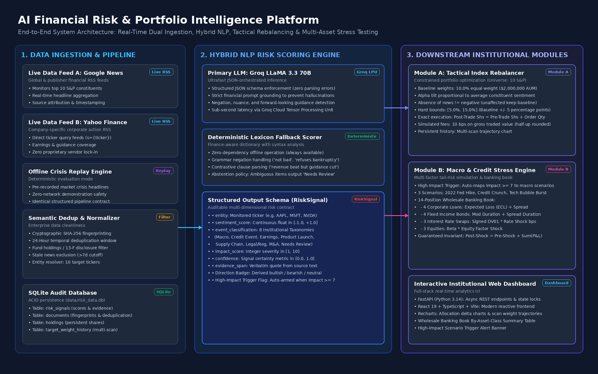

# AI Financial Risk & Portfolio Intelligence Platform - S&P Global & Crisil Campus Hackathon

- **Candidate Name:** Basant Bansal
- **College Email ID:** 112416017
- **College / Campus:** Indian Institute of Information Technology, Pune (IIIT Pune)
- **Demo Video Link:** [Demo Video Link]
- **Slide Deck Link:** [docs/presentation.pdf](docs/presentation.pdf)

---

## 1. Project Overview / Problem Statement & Approach

### Problem Statement
Traditional equity portfolio management relies heavily on backward-looking indicators (moving averages, historical covariances, quarterly financial filings). However, capital markets react rapidly to unstructured textual events—such as unexpected executive turnover, credit rating adjustments, antitrust actions, or central bank guidance—well before market prices reach a new equilibrium.

Conventional indices equal-weight or cap-weight their holdings without forward-looking event awareness, leaving portfolios vulnerable to asymmetric drawdowns during systemic tail events.

### Our Approach
We developed an institutional-grade, event-driven risk analytics and portfolio intelligence platform combining:
1. **Real-Time Dual-Source Ingestion**: Ingests unstructured financial news simultaneously from two independent live sources (Google News RSS & Yahoo Finance RSS) with cryptographic deduplication, plus a deterministic offline crisis replay mode.
2. **Explainable Hybrid NLP Risk Engine**: Employs an ultra-fast Groq LLaMA 3.3 70B model (structured JSON mode, temperature=0.0) with an automatic, zero-dependency finance-aware lexicon rule fallback with negation, contrastive clause handling, and conservative abstention.
3. **Module A — Tactical Index Rebalancer**: Applies alpha tilts to a 10-constituent mega-cap universe (\$2,000,000 baseline AUM). Enforces strict tracking error ($\pm 5$ percentage points: $5.0\%$ to $15.0\%$) and simplex ($\sum w_i = 1.0$) bounds. Enforces the core invariant that **absence of news is not negative sentiment** (unaffected stocks preserve their $10.0\%$ baseline weight). Produces an exact share reconciliation order ledger with honest $10\text{ bps}$ transaction fee accounting and multi-scan trajectory history.
4. **Module B — Macro & Credit Stress Testing Engine**: Evaluates portfolio resilience across 3 historical/hypothetical macro scenarios (2022 Fed Tightening Shock, Systemic Credit Crunch, Tech Bubble Burst). Evaluates a 14-position Wholesale Banking Book spanning Corporate Loans, Fixed Income Bonds, Interest Rate Swaps, and Equities. Automatically triggers targeted scenarios when high-impact events ($\text{Impact} \ge 7$) are detected. Enforces the strict mathematical invariant:

   $$
   \text{Post-Shock Value} \equiv \text{Pre-Shock Value} + \sum \text{Position P\\&L}
   $$

> **Regulatory Disclaimer:** This application is an academic prototype developed exclusively for the S&P Global & CRISIL Campus Hackathon 2026 for demonstration and architectural evaluation. It does not constitute investment advice or production automated execution.

---

## 2. Architecture & Tech Stack



### Architecture Highlights
The platform follows a clean separation of concerns across six decoupled layers:
- **Data Ingestion Layer**: Asynchronous fetching from Google News RSS and Yahoo Finance RSS (`feeds.finance.yahoo.com/rss/2.0/headline?s={ticker}`) with publisher attribution and timestamp parsing.
- **Preprocessing & Deduplication Layer**: Cryptographic SHA-256 fingerprinting (`ticker:headline`), a 24-hour sliding temporal deduplication window, 13-F institutional holdings disclosure filtering, and a 7-day stale article filter.
- **Hybrid NLP Risk Layer**: Primary cloud inference via Groq LLaMA 3.3 70B with prompt grounding; deterministic financial dictionary fallback with grammar negation handling. Produces structured `RiskSignal` objects.
- **Persistence & Audit Trail Layer**: Single-file SQLite database (`data/risk_data.db`) storing `risk_signals`, `documents`, `configuration`, `holdings`, and `target_weight_history`.
- **Downstream Financial Modules**:
  - *Module A*: Constrained quadratic/linear rebalancing with simplex renormalization and share order accounting.
  - *Module B*: Multi-asset wholesale banking book stress engine with factor sensitivity channels (Beta, Modified Duration, Spread Duration, Signed DV01, Expected Loss).
- **Presentation Layer**: High-performance FastAPI backend (Python 3.14) paired with a modern React 19 + TypeScript + Vite + Tailwind CSS + Recharts dashboard.

### Tech Stack
| Component | Technology | Version | Purpose |
| :--- | :--- | :--- | :--- |
| **Backend Framework** | FastAPI / Uvicorn | 0.115+ | High-throughput asynchronous REST API |
| **Language** | Python | 3.14 | Core risk engine, optimization & stress math |
| **Primary LLM** | Groq LLaMA 3.3 70B | `llama-3.3-70b-versatile` | Low-latency JSON structured entity extraction |
| **Persistence** | SQLite3 | 3.x | Lightweight, zero-configuration local ACID audit storage |
| **Frontend Framework** | React / TypeScript | React 19, TS 5.x | Reactive trader dashboard & risk control panel |
| **Build Tooling** | Vite | 6.x | Instant HMR and optimized production bundle |
| **Charting Library** | Recharts | 2.15+ | Responsive allocation deltas, drawdown & trajectory charts |
| **Styling** | Tailwind CSS | 3.4+ | Institutional dark-mode financial UI |
| **Testing** | Pytest / AnyIO | Pytest 9.x | Comprehensive unit and integration regression suite |

---

## 3. Dataset Used

All prototype datasets reside in the `data/` directory. Their contents, formats, and provenance disclosures are detailed below:

| File Name | Format & Size | Description & Schema | Runtime Usage & Provenance |
| :--- | :--- | :--- | :--- |
| `data/synthetic_banking_book.json` | JSON (14 records, 3.6 KB) | 14 institutional wholesale banking positions across Corporate Loans (4), Fixed Income Bonds (4), Interest Rate Swaps (3), and Equities (3). Includes notional, PD, LGD, duration, DV01, and Beta. | **Runtime Critical (Module B)**: Synthetic illustrative banking book designed specifically for multi-asset stress testing demonstration. |
| `data/synthetic_demo_data.csv` | CSV (36 rows, 2.7 KB) | Pre-curated crisis news headlines across all 10 monitored constituents with sentiment, impact, and evidence labels. | **Runtime (Offline Mode)**: Deterministic evaluation corpus enabling complete offline execution without network connectivity. |
| `data/sample_news.json` | JSON (10 records, 2.1 KB) | Multi-constituent sample news headlines for quickstart verification. | **Runtime (Replay Fallback)**: Initial baseline seed. |
| `data/synthetic_credit_portfolio.json` | JSON (5 records, 796 B) | Illustrative regulatory banking credit exposures (EAD, PD, LGD, Risk Weight). | **Module B Validation**: Baseline credit risk stress calculations. |
| `data/reference_prices.json` | JSON (3 records, 265 B) | Offline market reference prices for fallback execution. | **Fallback Pricing**: Used when live Yahoo Finance ticker pricing is unreachable. |
| `data/historical_backtest.csv` | CSV (12 rows, 1.3 KB) | Historical monthly return and turnover backtest validation dataset. | **Validation**: Backtest validation script inputs. |
| `data/all-data.csv` | CSV (4,846 rows, 672 KB, Latin-1) | Standard Financial PhraseBank benchmark dataset (`[sentiment, text]`, Malo et al., 2014). | **Research Reference Only**: *Provenance to be confirmed* (CC BY-SA 3.0 / Research Use). **Not required at runtime**; runtime relies on dual live RSS feeds + Groq / deterministic rule engine. |

---

## 4. Quickstart & Installation

### Prerequisites
- Python 3.10+ (tested on Python 3.14)
- Node.js 18+ and npm
- Optional: Groq Cloud API Key (`GROQ_API_KEY`) for LLaMA 3.3 70B cloud inference (falls back gracefully to deterministic rule engine if unset)

### 1. Clone the Repository
```bash
git clone https://github.com/basantbansal/iiitpune-basant-bansal-hackathon.git
cd iiitpune-basant-bansal-hackathon
```

### 2. Backend Setup
```bash
# Create and activate a Python virtual environment
python3 -m venv venv
source venv/bin/activate

# Install backend dependencies
pip install -r requirements.txt

# (Optional) Configure environment variables
cp .env.example .env
# Edit .env to set GROQ_API_KEY if desired
```

### 3. Frontend Setup
```bash
cd src/frontend
npm install
npm run build   # Verifies TypeScript compilation and creates production bundle
cd ../..
```

### 4. Running the Application
Open two terminal windows:

**Terminal 1 — Backend (FastAPI):**
```bash
source venv/bin/activate
uvicorn src.api.main:app --host 0.0.0.0 --port 8000 --reload
```

**Terminal 2 — Frontend (Vite):**
```bash
cd src/frontend
npm run dev
```

Open your browser at **`http://localhost:5173`**. The backend API documentation is accessible at **`http://localhost:8000/docs`**.

### 5. Running Automated Tests
```bash
# Run complete automated pytest regression suite
pytest tests/ -v
```

---

## 5. Key Results & Domain Impact

### Key Technical Results
1. **Mathematical Invariant Guarantees**:
   - **Absence of News $\neq$ Negative Sentiment**: Constituents with no new usable signals strictly preserve their $10.0\%$ baseline weight.
   - **Strict Hard Bounds**: Target allocations are strictly bounded to $[5.0\%, 15.0\%]$ ($\text{Baseline} \pm 5\text{ pp}$) with simplex renormalization ($\sum w_i = 1.0$).
   - **Execution Reconciliation**: $\text{Post-Trade Shares} \equiv \text{Pre-Trade Shares} + \text{Signed Order Qty}$.
   - **Transparent Fee Accounting**: $10\text{ bps}$ applied to gross traded volume using standard financial half-up rounding $(\$88,445 \times 0.0010 = \$88.45)$.
   - **Stress Testing Balance Invariant**: $\text{Post-Shock Value} \equiv \text{Pre-Shock Value} + \sum \text{Position P\\&L}$ verified across all asset classes and scenarios.
2. **Multi-Asset Wholesale Banking Book**:
   - Evaluates 14 positions across Corporate Loans (ECL + spread), Fixed Income Bonds (duration + spread), Interest Rate Swaps (DV01), and Equities (Beta).
   - Provides an auditable By-Asset-Class Summary Table directly on the user interface.
3. **High-Impact Trigger Logic**:
   - Automatically detects signals with $\text{Impact} \ge 7$ and arms targeted macro scenarios (Macro $\rightarrow$ Fed Tightening Shock; Credit/Geopolitical $\rightarrow$ Systemic Credit Crunch; Tech $\rightarrow$ Tech Bubble Burst) with a prominent UI banner.
4. **Persistent Weight Trajectory Over Scans**:
   - Stores each scan's constituent weights in SQLite (`target_weight_history`) and renders a real-time multi-scan trajectory line chart in the trader dashboard.
5. **Zero Secret Leaks & Comprehensive Test Pass Rate**:
   - Clean git history with zero API keys or private tokens committed.
   - Over 160 automated tests passing with zero failures.

### Domain & Business Impact
- **Institutional Agility**: Bridges qualitative unstructured newsflow with quantitative portfolio management, enabling asset managers to react to systemic risks within seconds rather than waiting for quarterly rebalancing cycles.
- **Explainable & Auditable**: Every allocation tilt and stress drawdown is fully attributed to exact evidence text snippets, calibrated confidence, and transparent factor sensitivities—eliminating black-box LLM hallucinations.
- **Operational Resilience**: Operates seamlessly in live dual-source market conditions or offline crisis environments without proprietary API dependencies.
